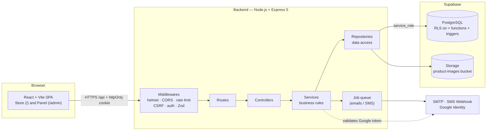
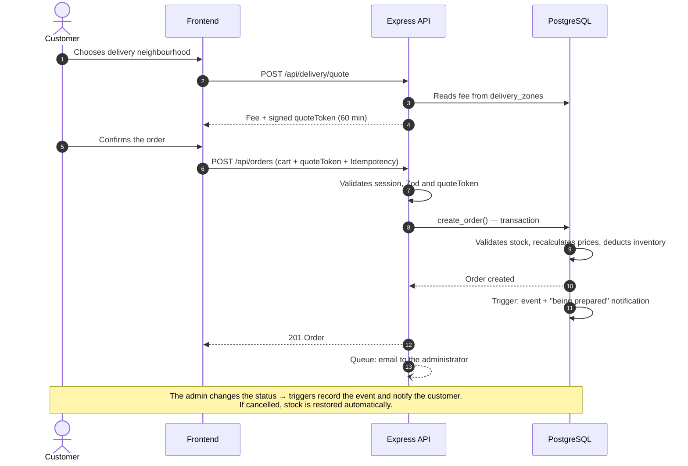
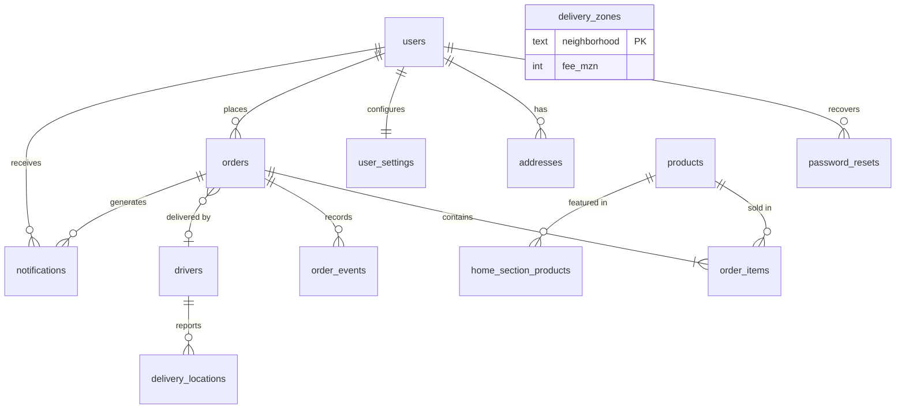

<div align="center">

# NhongaExpress

**A complete online store with an admin panel, mobile-wallet checkout and per-neighbourhood delivery — built for the city of Beira, Mozambique.**


</div>

---

## Table of Contents

1. [Overview](#overview)
2. [Screenshots](#screenshots)
3. [Features](#features)
4. [Architecture](#architecture)
5. [Project Structure](#project-structure)
6. [Section-by-Section Guide](#section-by-section-guide)
7. [Order Flow](#order-flow)
8. [Database](#database)
9. [REST API](#rest-api)
10. [Security](#security)
11. [Getting Started](#getting-started)
12. [Environment Variables](#environment-variables)
13. [Available Scripts](#available-scripts)
14. [Technical Decisions and Known Limitations](#technical-decisions-and-known-limitations)
15. [Next Steps](#next-steps)
16. [Author](#author)

---

## Overview

**NhongaExpress** is a *full stack* e-commerce application for selling electronics, accessories and gadgets. Customers browse the catalogue, save favourites, build a cart, choose their delivery neighbourhood, pay with **M-Pesa**, **e-Mola** or **cash on delivery**, and follow their order in real time. The store team manages everything (products, categories, orders, drivers and fees) from an **admin panel** inside the same application.

The project was designed around three principles:

- **The server is the source of truth.** Prices, stock and delivery costs are always recalculated on the backend; the client can never submit a value of its own.
- **Layered security.** `httpOnly` cookies, Zod validation, rate limiting, origin-based CSRF protection, RLS enabled on the database, and a privileged key that exists only on the server.
- **Local context.** Prices in MT, Mozambican phone numbers (82–87), local mobile wallets and delivery by Beira neighbourhoods.

---

## Screenshots

| Store — home page | Admin panel |
|:---:|:---:|
|  |  |

| Sign in / Sign up |
|:---:|
|  |

---

## Features

### For customers
- Catalogue with **categories**, category search and home-page sections (featured, deals, new arrivals, best sellers, recommended).
- **Favourites** and **cart** persisted in the browser.
- **Sign up and login** by email *or* phone, **Google** login, and a **continue as guest** option.
- Password recovery by code (SMTP email or SMS via webhook).
- **Saved addresses** (up to 5) with a default address, plus account settings.
- **Checkout** with per-neighbourhood delivery quotes and three payment methods.
- **Order tracking** (received → being prepared → on the way → delivered) and near real-time driver location.
- **Notification centre** (bell) with automatic alerts on every status change.
- Cookies with explicit consent.

### For administrators
- **Dashboard** with customers, active products, orders and revenue, plus a list of recent orders.
- Product **CRUD** with image upload (validated by the file's actual bytes).
- Management of **categories** (with icons) and **home-page sections**.
- **Order** management: change status, assign a driver, view event history, bulk actions.
- Management of **drivers** and **per-neighbourhood fees**.
- List of registered **customers**.

---

## Architecture

The system follows a **three-tier client–server architecture**: a React SPA, an Express REST API and PostgreSQL managed by Supabase. The frontend **never talks directly to the database**; all access goes through the API.



### Backend layered pattern

Every HTTP request goes through the same layers, each with a single responsibility:

| Layer | Folder | Responsibility |
|---|---|---|
| **Middleware** | `middleware/` | Authentication, admin role, validation (Zod), request limits, error handling. |
| **Routes** | `routes/` | Maps URL + HTTP method to a controller and declares which middlewares protect each route. |
| **Controllers** | `controllers/` | Reads the HTTP request, calls the service and returns the response. No business rules. |
| **Services** | `services/` | Business rules: authentication, delivery quotes, order creation, notifications. |
| **Repositories** | `repositories/` | The only place that talks to Supabase. Switching databases only affects this layer. |
| **Schemas** | `schemas/` | Input contracts validated with Zod (sign-up, login, order, address…). |
| **Utils / Config** | `utils/`, `config/` | JWT, cookies, job queue, image detection and validated `.env` loading. |

### Architecture decisions

- **Critical logic lives in the database.** Creating an order is a transactional SQL function (`create_order`): it validates stock, saves items, deducts inventory and guarantees idempotency. Triggers restore stock on cancellation, record history and generate notifications.
- **The backend is the only database client.** Every table has RLS enabled **with no policies**, so the public key can neither read nor write anything. Only the backend, using the `service_role` key, accesses the data.
- **A single login for store and panel.** The administrator is a regular account with `role = 'admin'`. The role is read from the database on every request, so revoking access takes effect immediately.
- **Delivery with a signed quote.** The server calculates the fee by neighbourhood and returns a `quoteToken` (a JWT with its own audience, valid for 60 minutes). Checkout sends the token back, and that is where the delivery cost comes from.
- **Background tasks.** Sending emails/SMS does not block the checkout response: jobs go into a queue with limited concurrency and retries with increasing delay.

---

## Project Structure

```text
nhongaexpress/
├── backend/
│   ├── scripts/
│   │   ├── make-admin.ts              # promotes/creates administrators
│   │   ├── create-admin.mjs
│   │   ├── geocode-bairros.mjs        # generates neighbourhood coordinates (OpenStreetMap)
│   │   ├── bairros-coordenadas.csv
│   │   └── bairros-coordenadas.sql
│   ├── src/
│   │   ├── config/                    # env.ts (.env validation) and supabase.ts
│   │   ├── controllers/               # auth, account, orders, store, home, categories, delivery, admin
│   │   ├── database/
│   │   │   └── nhongaexpress.sql      # full schema (tables, functions, triggers, storage)
│   │   ├── middleware/                # auth, adminAuth, validate, rateLimit, ipRateLimit, errorHandler
│   │   ├── repositories/              # users, products, orders, drivers, categories, account...
│   │   ├── routes/                    # index.ts groups everything under /api
│   │   ├── schemas/                   # Zod validation
│   │   ├── services/                  # business rules
│   │   ├── utils/                     # jwt, cookie, jobQueue, notifier, image, identifier...
│   │   ├── app.ts                     # builds Express and the global protections
│   │   └── server.ts                  # opens the port and handles graceful shutdown
│   └── .env.example
│
└── frontend/
    ├── public/
    ├── src/
    │   ├── pages/                     # App.tsx (store), DeliveryLive, PaymentIcons, main.tsx
    │   ├── admin/                     # AdminApp.tsx (panel), DeliverySettings, adminApi
    │   ├── services/                  # api.ts (HTTP client), data, route, social, categoryIcons
    │   ├── assets/payment/            # M-Pesa and e-Mola logos
    │   └── css/styles.css
    ├── index.html
    ├── vite.config.ts                 # proxy /api -> http://localhost:4000
    └── .env.example
```

---

## Section-by-Section Guide

### Store — home page

| Area | What it does |
|---|---|
| **Header** | Logo, search bar (filters by the active category) and shortcuts: home, categories, favourites, notifications, cart, help and account avatar. |
| **Shop by categories** | Side menu with categories coming from the API (e.g. Phone accessories, Audio, Computers, Games, Mobile phones). The *See all categories* button opens the full list. |
| **Featured product** | Main *banner* with name, category, description, spec sheet and a **Buy now** button. Fed by the `featured` section, managed in the panel. |
| **Category chips** | Horizontal quick filters to jump between categories. |
| **Deals and promotions** | Grid of cards with image, category, price in MT, a favourite button and **Add to cart**. Fed by the `offers` section. |

### Sign in / Sign up

| Element | Behaviour |
|---|---|
| **Sign in / Sign up tabs** | Switch between login and account creation in the same card. |
| **Email or phone** | The identifier is normalised and validated (phone in the Mozambican format `8[2-7]XXXXXXX`). |
| **Forgot password?** | Starts recovery: generates a code with an expiry, sent by email or SMS. |
| **Keep me signed in** | Chooses the JWT lifetime: **7 days** (checked) or **12 hours** (unchecked, with a session cookie). |
| **Continue with Google** | Social login; the API validates Google's *ID token*. Without `GOOGLE_CLIENT_ID` the route returns 503. |
| **Continue as guest** | Allows browsing without an account; checkout requires login. |
| **Terms of Use and Privacy Policy** | Acceptance required before creating the account. |

### Admin panel

| Menu | What is managed |
|---|---|
| **Dashboard** | Cards with total **customers**, **active products**, **orders** and **revenue**, and a table of **recent orders** (number, customer, total, status, date). |
| **Products** | Create, edit and delete; set price, stock, category and images. Uploads up to 5 MB (JPG, PNG, WebP, AVIF). |
| **Categories** | Add and edit categories; the icon is suggested automatically from the name. |
| **Home page** | Choose which products appear in each section: featured, deals, new arrivals, best sellers and recommended. |
| **Customers** | View registered users. |
| **Orders** | List, filter and change status (individually or in bulk), assign a driver and view event history. |
| **Drivers** | Register and manage the delivery team. |
| **Delivery settings** | Fixed fee in MT per Beira neighbourhood. |
| **View store / Sign out** | Go back to the store or end the session (clears the cookie). |

---

## Order Flow



**Order statuses:** `pending` → `paid` → `processing` → `shipped` → `completed` (or `cancelled`).

---

## Database

The schema lives in `backend/src/database/nhongaexpress.sql` and is **idempotent**: it can be run again without damaging data. It is organised into numbered sections (accounts, catalogue, delivery, customer account, orders, notifications, triggers, images, permissions).



| Table | Purpose |
|---|---|
| `users` | Customers and administrators (`role`: `customer` or `admin`); requires an email or phone. |
| `password_resets` | Recovery codes with an expiry. |
| `categories`, `products` | Catalogue (price ≥ 0, stock ≥ 0). |
| `home_section_products` | Link between a product and a home-page section. |
| `drivers`, `delivery_zones`, `delivery_locations` | Drivers, per-neighbourhood fee and last known position. |
| `addresses`, `user_settings` | Customer addresses and preferences. |
| `orders`, `order_items`, `order_events` | Order, lines (with frozen price) and status history. |
| `notifications` | Bell alerts (types `order`, `offer`, `system`). |

**Relevant functions and triggers:** `create_order`, `replace_home_section`, `set_default_address`, `orders_restock_on_cancel`, `orders_log_events`, `orders_notify_status`, `set_updated_at`.

---

## REST API

All routes live under the `/api` prefix. Legend: public · session · administrator.

### Authentication — `/api/auth`
| Method | Route | Access | Description |
|---|---|:---:|---|
| POST | `/register` | Public | Creates an account (per-IP creation limit). |
| POST | `/login` | Public | Signs in and sets the cookie. |
| POST | `/google` | Public | Google login. |
| POST | `/logout` | Public | Ends the session. |
| GET / PATCH | `/me` | Session | Read / update profile. |
| POST | `/change-password` | Session | Change password. |
| POST | `/forgot-password` · `/reset-password` | Public | Recovery by code. |

### Store and account
| Method | Route | Access | Description |
|---|---|:---:|---|
| GET | `/home` | Public | Home-page sections. |
| GET | `/products` | Public | Public catalogue. |
| GET | `/categories` | Public | Categories and icons. |
| GET / POST / PUT / DELETE | `/account/addresses` (+ `/:id/default`) | Session | Addresses. |
| GET / PATCH | `/account/settings` | Session | Account settings. |

### Orders and delivery
| Method | Route | Access | Description |
|---|---|:---:|---|
| POST | `/orders/validate` | Public | Validates the cart (current prices and stock). |
| GET | `/orders` | Session | Customer's orders. |
| POST | `/orders` | Session | Creates an order (idempotent). |
| POST | `/orders/:id/cancel` | Session | Cancels an order. |
| DELETE | `/orders/:id` | Session | Removes an order from the history. |
| POST | `/delivery/quote` | Public | Signed delivery quote. |
| GET | `/delivery/zones` | Public | Neighbourhoods and fees. |
| GET | `/delivery/orders/:id/location` | Session | Driver position. |
| PUT | `/delivery/orders/:id/location` | Admin | Updates the driver position. |

### Administration — `/api/admin` (admin)
`/me`, `/dashboard`, `/products` (CRUD), `/uploads`, `/categories` (CRUD), `/home-sections` (list, replace, add, remove), `/customers`, `/drivers` (CRUD) and `/orders` (list, status, driver, events, delete, `bulk-status`, `bulk-delete`). Per-neighbourhood fees are managed via `GET /delivery/zones/admin` and `PUT /delivery/zones/:neighborhood` (also admin).

Health check: `GET /api/health` → `{ "status": "ok" }`.

---

## Security

| Threat | Protection implemented |
|---|---|
| Session theft via XSS | JWT stored in an **`httpOnly`** cookie (`nx_token`); browser JavaScript cannot read it. |
| CSRF | Configurable `SameSite` cookie + `sameOriginOnly` middleware that rejects writes from another origin + CORS restricted to `CLIENT_ORIGIN`. |
| Brute force and abuse | `express-rate-limit`: 300 requests/15 min per IP in general; 10 failures/15 min on login; 10 sign-ups/hour per IP; dedicated limits on checkout, quotes and recovery. |
| Passwords | Hashed with **bcrypt**; recovery by code with an expiry. |
| Injection and invalid data | All inputs validated with **Zod** before reaching the controller. |
| Insecure headers | **Helmet** and removal of `X-Powered-By`. |
| Oversized bodies | JSON limited to 10 kb; image uploads limited to 5 MB. |
| Malicious uploads | Image type is detected from the **actual bytes**, not from the `Content-Type` or extension. |
| Price tampering | Prices, stock and delivery fee recalculated on the server; quote is a signed JWT with its own audience. |
| Duplicate orders | Idempotency key + order *hash* in the `create_order` function. |
| Direct database access | **RLS enabled with no policies**; `service_role` exists only on the backend. |
| Privilege escalation | The `admin` role is read from the database on every request; it does not live in the token. |
| Insecure configuration | The server **will not start** if the `.env` is incomplete or `JWT_SECRET` is too short (< 32 characters). |

---

## Getting Started

### Prerequisites
- **Node.js 20+** and npm
- A project on **[Supabase](https://supabase.com)** (the free plan is enough)

### 1. Clone and install
```bash
git clone https://github.com/felizardolmatola/nhongaexpress.git
cd nhongaexpress

cd backend  && npm install && cd ..
cd frontend && npm install && cd ..
```

### 2. Create the database
In Supabase open **SQL Editor → New query**, paste the contents of `backend/src/database/nhongaexpress.sql` and click **Run**. The script is safe to run repeatedly.

### 3. Configure the environment
```bash
cp backend/.env.example  backend/.env
cp frontend/.env.example frontend/.env
```
Fill in `SUPABASE_URL`, `SUPABASE_SERVICE_ROLE_KEY` and `JWT_SECRET` (generate one with `openssl rand -hex 48`). See the [full table](#environment-variables).

### 4. Start the app
```bash
# Terminal 1 — API at http://localhost:4000
cd backend && npm run dev

# Terminal 2 — Store at http://localhost:5173
cd frontend && npm run dev
```
In development Vite proxies `/api` to the backend, so there are no CORS issues.

### 5. Create the administrator
Sign up for a regular account in the store and promote it:
```bash
cd backend
npm run admin:promote -- your-email@example.com
```
Then open the panel at **`/admin`** with that same account.

### 6. (Optional) Neighbourhood coordinates
```bash
node scripts/geocode-bairros.mjs   # generates CSV + SQL for manual review
```

---

## Environment Variables

### Backend (`backend/.env`)

| Variable | Required | Description |
|---|:---:|---|
| `PORT` | no | API port (default `4000`). |
| `NODE_ENV` | no | `development`, `production` or `test`. |
| `CLIENT_ORIGIN` | **yes** | Authorised frontend URL (CORS and CSRF protection). |
| `SUPABASE_URL` | **yes** | Supabase project URL. |
| `SUPABASE_SERVICE_ROLE_KEY` | **yes** | Secret `service_role` key. **Never** expose it in the frontend. |
| `JWT_SECRET` | **yes** | Signing secret (min. 32 characters). |
| `JWT_EXPIRES_IN` / `JWT_SHORT_EXPIRES_IN` | no | Long (`7d`) and short (`12h`) session lifetimes. |
| `COOKIE_SAMESITE` | no | `lax`, `strict` or `none` (different domains require HTTPS). |
| `TRUST_PROXY` | no | Number of proxies in front of the API (1 on Render/Railway/Nginx). |
| `GOOGLE_CLIENT_ID` | no | Enables Google login. |
| `SMTP_HOST`, `SMTP_PORT`, `SMTP_USER`, `SMTP_PASS`, `MAIL_FROM` | no | Email sending. Without these, in development the code is printed to the console. |
| `ADMIN_NOTIFY_EMAIL` | no | Who receives new-order alerts (empty = admins' emails). |
| `SMS_WEBHOOK_URL`, `SMS_WEBHOOK_TOKEN` | no | SMS gateway for phone-only accounts. |

### Frontend (`frontend/.env`)

| Variable | Description |
|---|---|
| `VITE_API_URL` | API URL in production. Leave empty in development. |
| `VITE_GOOGLE_CLIENT_ID` | Same ID as the backend, for the Google button. |

---

## Available Scripts

| Folder | Command | What it does |
|---|---|---|
| `backend` | `npm run dev` | API with *hot reload* (`tsx watch`). |
| `backend` | `npm run build` | Compiles TypeScript to `dist/`. |
| `backend` | `npm start` | Runs the production build. |
| `backend` | `npm run typecheck` | Checks types without emitting files. |
| `backend` | `npm run admin:promote -- <email\|phone>` | Promotes (or creates) an administrator; `--remove` reverts to customer. |
| `frontend` | `npm run dev` | Vite development server. |
| `frontend` | `npm run build` | Type-checks and produces the production build. |
| `frontend` | `npm run preview` | Previews the build. |

---

## Technical Decisions and Known Limitations

- **In-memory job queue.** Pending jobs are lost if the process restarts. The `enqueue()` module was isolated so it can be swapped for BullMQ/Redis or a `jobs` table without changing the rest of the code.
- **Delivery by zone, not distance.** A fixed fee per neighbourhood: simple, predictable and editable by the administrator.
- **Tracking via *polling*.** The driver's position updates every 5 seconds; WebSockets or Supabase Realtime would be the natural evolution.
- **M-Pesa/e-Mola payments recorded, not integrated.** The method is saved on the order; automatic confirmation through the operator's API does not exist yet.
- **Frontend without a routing library.** Navigation uses a custom module (`services/route.ts`); the panel lives at `/admin`.

---

## Next Steps

- [ ] Real integration with the M-Pesa and e-Mola APIs
- [ ] Automated tests (Vitest + Supertest)
- [ ] Persistent queue for emails and SMS
- [ ] Real-time order status updates
- [ ] Split `App.tsx` into smaller components and pages
- [ ] CI with GitHub Actions (typecheck + build)
- [ ] Documented deployment (Render/Railway + Vercel)

---

## Author

**Felizardo Lázaro Matola** — Full Stack Developer

> *Clean code, clear ideas, real results.*

- GitHub: [github.com/felizardolmatola](https://github.com/felizardolmatola)
- LinkedIn: [linkedin.com/in/felizardolazaro-matola-b1097340a](https://linkedin.com/in/felizardolazaro-matola-b1097340a)
- Email: felizardolmatola@gmail.com
