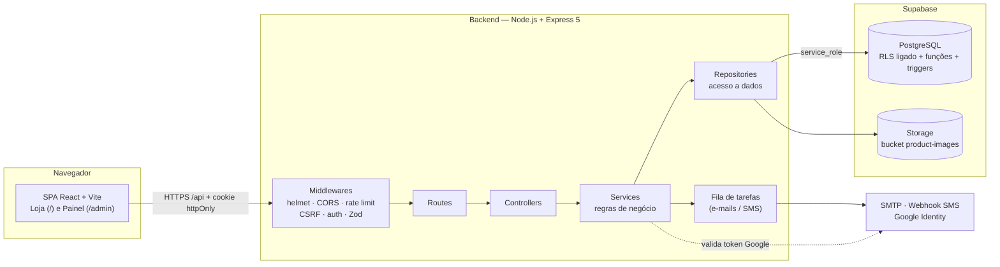
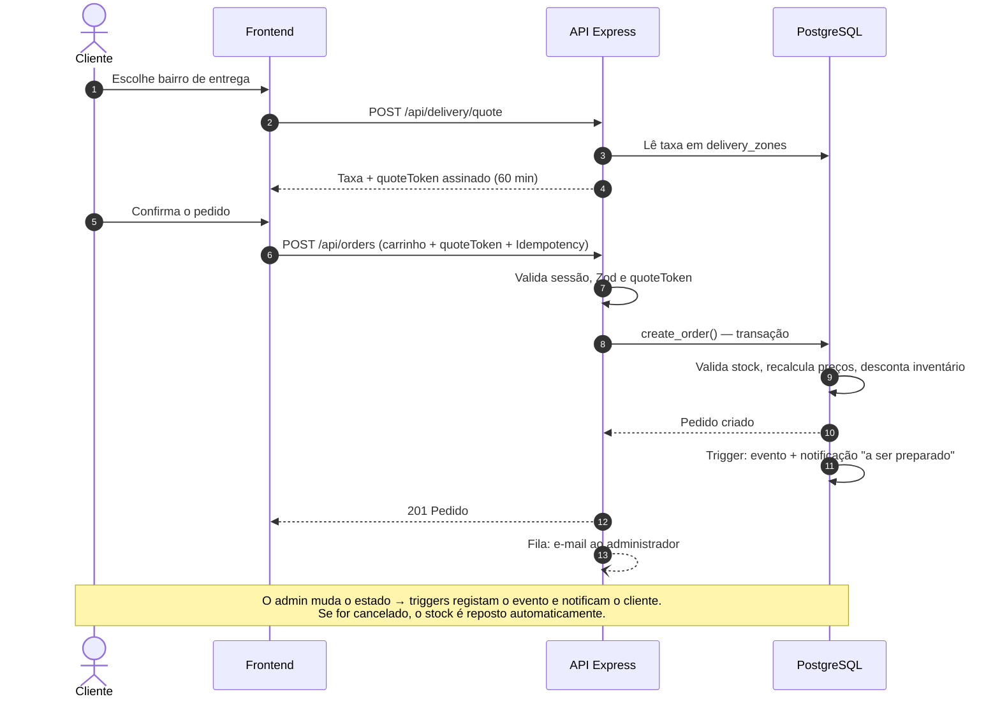
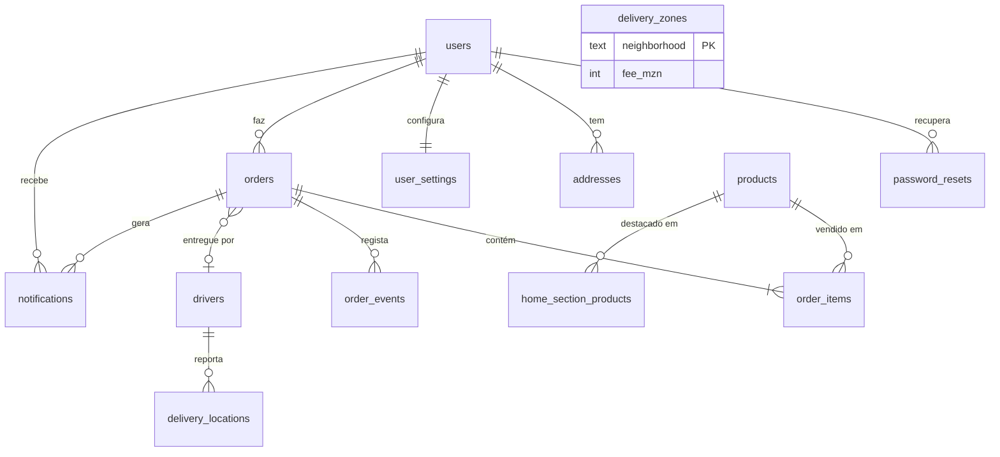

<div align="center">

# NhongaExpress

**Loja online completa com painel administrativo, checkout com carteiras móveis e entrega por bairro — pensada para a cidade da Beira, Moçambique.**


</div>

---

## Índice

1. [Visão geral](#visão-geral)
2. [Capturas de ecrã](#capturas-de-ecrã)
3. [Funcionalidades](#funcionalidades)
4. [Arquitetura](#arquitetura)
5. [Estrutura do projeto](#estrutura-do-projeto)
6. [Explicação de cada secção](#explicação-de-cada-secção)
7. [Fluxo de um pedido](#fluxo-de-um-pedido)
8. [Base de dados](#base-de-dados)
9. [API REST](#api-rest)
10. [Segurança](#segurança)
11. [Como executar](#como-executar)
12. [Variáveis de ambiente](#variáveis-de-ambiente)
13. [Scripts disponíveis](#scripts-disponíveis)
14. [Decisões técnicas e limitações conhecidas](#decisões-técnicas-e-limitações-conhecidas)
15. [Próximos passos](#próximos-passos)
16. [Autor](#autor)

---

## Visão geral

O **NhongaExpress** é uma aplicação de e-commerce *full stack* para venda de eletrónicos, acessórios e gadgets. O cliente navega pelo catálogo, guarda favoritos, monta o carrinho, escolhe o bairro de entrega, paga com **M-Pesa**, **e-Mola** ou **pagamento na entrega** e acompanha o pedido em tempo real. A equipa da loja gere tudo (produtos, categorias, pedidos, entregadores e taxas) num **painel administrativo** dentro da mesma aplicação.

O projeto foi desenhado com três princípios:

- **O servidor é a fonte da verdade.** Preços, stock e custo de entrega são sempre recalculados no backend; o cliente nunca consegue enviar um valor seu.
- **Segurança por camadas.** Cookies `httpOnly`, validação com Zod, *rate limiting*, proteção CSRF por origem, RLS ligado no banco e chave privilegiada só no servidor.
- **Contexto local.** Moeda em MT, números de telefone moçambicanos (82–87), carteiras móveis locais e entrega por bairros da Beira.

---

## Capturas de ecrã

| Loja — página inicial | Painel administrativo |
|:---:|:---:|
|  |  |

| Entrar / Registar |
|:---:|
|  |

---

## Funcionalidades

### Para o cliente
- Catálogo com **categorias**, pesquisa por categoria e secções da página inicial (destaque, ofertas, novidades, mais vendidos, recomendados).
- **Favoritos** e **carrinho** persistidos no navegador.
- **Registo e login** por e-mail *ou* telefone, login com **Google** e opção de **continuar como convidado**.
- Recuperação de palavra-passe por código (e-mail SMTP ou SMS via webhook).
- **Moradas guardadas** (até 5) com morada padrão, e definições da conta.
- **Checkout** com cotação de entrega por bairro e três formas de pagamento.
- **Acompanhamento do pedido** (recebido → em preparação → a caminho → entregue) e localização do entregador em tempo quase real.
- **Centro de notificações** (sino) com avisos automáticos a cada mudança de estado.
- Cookies com consentimento explícito.

### Para o administrador
- **Dashboard** com clientes, produtos ativos, pedidos e receita, mais a lista de pedidos recentes.
- CRUD de **produtos** com upload de imagens (validado pelos bytes reais do ficheiro).
- Gestão de **categorias** (com ícones) e das **secções da página inicial**.
- Gestão de **pedidos**: mudar estado, atribuir entregador, ver histórico de eventos, ações em massa.
- Gestão de **entregadores** e de **taxas por bairro**.
- Lista de **clientes** registados.

---

## Arquitetura

O sistema segue uma arquitetura **cliente–servidor em três camadas**: uma SPA em React, uma API REST em Express e o PostgreSQL gerido pelo Supabase. O frontend **nunca fala diretamente com o banco**; todo o acesso passa pela API.



### Padrão em camadas do backend

Cada pedido HTTP atravessa as mesmas camadas, cada uma com uma única responsabilidade:

| Camada | Pasta | Responsabilidade |
|---|---|---|
| **Middleware** | `middleware/` | Autenticação, papel de administrador, validação (Zod), limites de pedidos, tratamento de erros. |
| **Routes** | `routes/` | Mapeia URL + método HTTP para um controller e declara quais middlewares protegem cada rota. |
| **Controllers** | `controllers/` | Lê o pedido HTTP, chama o service e devolve a resposta. Sem regras de negócio. |
| **Services** | `services/` | Regras de negócio: autenticação, cotação de entrega, criação de pedidos, notificações. |
| **Repositories** | `repositories/` | Único ponto que fala com o Supabase. Trocar de banco só afeta esta camada. |
| **Schemas** | `schemas/` | Contratos de entrada validados com Zod (registo, login, pedido, morada…). |
| **Utils / Config** | `utils/`, `config/` | JWT, cookies, fila de tarefas, deteção de imagens e leitura validada do `.env`. |

### Decisões de arquitetura

- **Lógica crítica no banco.** Criar um pedido é uma função SQL (`create_order`) transacional: valida stock, grava itens, desconta inventário e garante idempotência. Triggers repõem o stock ao cancelar, registam o histórico e geram notificações.
- **Backend como único cliente do banco.** Todas as tabelas têm RLS ligado **sem políticas**, logo a chave pública não lê nem escreve nada. Só o backend, com a chave `service_role`, acede aos dados.
- **Um só login para loja e painel.** O administrador é uma conta normal com `role = 'admin'`. O papel é lido do banco a cada pedido, por isso retirar o acesso tem efeito imediato.
- **Entrega com cotação assinada.** O servidor calcula a taxa pelo bairro e devolve um `quoteToken` (JWT com audiência própria, válido 60 min). O checkout reenvia o token e é daí que sai o custo de entrega.
- **Tarefas em segundo plano.** O envio de e-mails/SMS não bloqueia a resposta do checkout: vai para uma fila com concorrência limitada e novas tentativas com espera crescente.

---

## Estrutura do projeto

```text
nhongaexpress/
├── backend/
│   ├── scripts/
│   │   ├── make-admin.ts              # promove/cria administradores
│   │   ├── create-admin.mjs
│   │   ├── geocode-bairros.mjs        # gera coordenadas dos bairros (OpenStreetMap)
│   │   ├── bairros-coordenadas.csv
│   │   └── bairros-coordenadas.sql
│   ├── src/
│   │   ├── config/                    # env.ts (validação do .env) e supabase.ts
│   │   ├── controllers/               # auth, account, orders, store, home, categories, delivery, admin
│   │   ├── database/
│   │   │   └── nhongaexpress.sql      # esquema completo (tabelas, funções, triggers, storage)
│   │   ├── middleware/                # auth, adminAuth, validate, rateLimit, ipRateLimit, errorHandler
│   │   ├── repositories/              # users, products, orders, drivers, categories, account...
│   │   ├── routes/                    # index.ts agrupa tudo sob /api
│   │   ├── schemas/                   # validação Zod
│   │   ├── services/                  # regras de negócio
│   │   ├── utils/                     # jwt, cookie, jobQueue, notifier, image, identifier...
│   │   ├── app.ts                     # monta o Express e as proteções globais
│   │   └── server.ts                  # abre a porta e faz encerramento limpo
│   └── .env.example
│
└── frontend/
    ├── public/
    ├── src/
    │   ├── pages/                     # App.tsx (loja), DeliveryLive, PaymentIcons, main.tsx
    │   ├── admin/                     # AdminApp.tsx (painel), DeliverySettings, adminApi
    │   ├── services/                  # api.ts (cliente HTTP), data, route, social, categoryIcons
    │   ├── assets/payment/            # logótipos M-Pesa e e-Mola
    │   └── css/styles.css
    ├── index.html
    ├── vite.config.ts                 # proxy /api -> http://localhost:4000
    └── .env.example
```

---

## Explicação de cada secção

### Loja — página inicial

| Zona | O que faz |
|---|---|
| **Cabeçalho** | Logótipo, barra de pesquisa (filtra pela categoria ativa) e atalhos: início, categorias, favoritos, notificações, carrinho, ajuda e avatar da conta. |
| **Comprar por categorias** | Menu lateral com as categorias vindas da API (ex.: Acessórios para telemóveis, Áudio, Computadores, Games, Celulares). O botão *Ver todas as categorias* abre a lista completa. |
| **Produto em destaque** | *Banner* principal com nome, categoria, descrição, ficha de especificações e botão **Comprar agora**. Alimentado pela secção `featured`, gerida no painel. |
| **Chips de categorias** | Filtros rápidos horizontais para saltar entre categorias. |
| **Ofertas e promoções** | Grelha de cartões com imagem, categoria, preço em MT, botão de favorito e **Adicionar ao carrinho**. Alimentada pela secção `offers`. |

### Entrar / Registar

| Elemento | Comportamento |
|---|---|
| **Separadores Entrar / Registar** | Alternam entre login e criação de conta no mesmo cartão. |
| **E-mail ou telefone** | O identificador é normalizado e validado (telefone no formato moçambicano `8[2-7]XXXXXXX`). |
| **Esqueceu a palavra-passe?** | Inicia a recuperação: gera um código com validade, enviado por e-mail ou SMS. |
| **Manter sessão iniciada** | Escolhe a duração do JWT: **7 dias** (marcado) ou **12 horas** (desmarcado, com cookie de sessão). |
| **Continuar com Google** | Login social; a API valida o *ID token* do Google. Sem `GOOGLE_CLIENT_ID` a rota responde 503. |
| **Continuar como convidado** | Permite navegar sem conta; o checkout exige login. |
| **Termos de uso e Política de privacidade** | Aceitação obrigatória antes de criar a conta. |

### Painel administrativo

| Menu | O que se gere |
|---|---|
| **Dashboard** | Cartões com total de **clientes**, **produtos ativos**, **pedidos** e **receita**, e tabela de **pedidos recentes** (número, cliente, total, estado, data). |
| **Produtos** | Criar, editar, apagar, definir preço, stock, categoria e imagens. Upload até 5 MB (JPG, PNG, WebP, AVIF). |
| **Categorias** | Adicionar e editar categorias; o ícone é sugerido automaticamente a partir do nome. |
| **Página inicial** | Escolhe que produtos aparecem em cada secção: destaque, ofertas, novidades, mais vendidos e recomendados. |
| **Clientes** | Consulta dos utilizadores registados. |
| **Pedidos** | Lista, filtro e alteração de estado (individual ou em massa), atribuição de entregador e histórico de eventos. |
| **Entregadores** | Registo e gestão da equipa de entrega. |
| **Configuração de entrega** | Taxa fixa em MT por bairro da Beira. |
| **Ver a loja / Terminar sessão** | Volta à loja ou encerra a sessão (limpa o cookie). |

---

## Fluxo de um pedido



**Estados do pedido:** `pending` → `paid` → `processing` → `shipped` → `completed` (ou `cancelled`).

---

## Base de dados

O esquema vive em `backend/src/database/nhongaexpress.sql` e é **idempotente**: pode correr-se de novo sem estragar dados. Está organizado em secções numeradas (contas, catálogo, entrega, conta do cliente, pedidos, notificações, triggers, imagens, permissões).



| Tabela | Função |
|---|---|
| `users` | Clientes e administradores (`role`: `customer` ou `admin`); exige e-mail ou telefone. |
| `password_resets` | Códigos de recuperação com validade. |
| `categories`, `products` | Catálogo (preço ≥ 0, stock ≥ 0). |
| `home_section_products` | Ligação produto ↔ secção da página inicial. |
| `drivers`, `delivery_zones`, `delivery_locations` | Entregadores, taxa por bairro e última posição conhecida. |
| `addresses`, `user_settings` | Moradas e preferências do cliente. |
| `orders`, `order_items`, `order_events` | Pedido, linhas (com preço congelado) e histórico de estados. |
| `notifications` | Avisos do sino (tipos `order`, `offer`, `system`). |

**Funções e triggers relevantes:** `create_order`, `replace_home_section`, `set_default_address`, `orders_restock_on_cancel`, `orders_log_events`, `orders_notify_status`, `set_updated_at`.

---

## API REST

Todas as rotas ficam sob o prefixo `/api`. Legenda: 🌐 pública · 🔐 sessão · 🛡️ administrador.

### Autenticação — `/api/auth`
| Método | Rota | Acesso | Descrição |
|---|---|:---:|---|
| POST | `/register` | 🌐 | Cria conta (limite de criação por IP). |
| POST | `/login` | 🌐 | Inicia sessão e define o cookie. |
| POST | `/google` | 🌐 | Login com Google. |
| POST | `/logout` | 🌐 | Termina a sessão. |
| GET / PATCH | `/me` | 🔐 | Ler / atualizar perfil. |
| POST | `/change-password` | 🔐 | Alterar palavra-passe. |
| POST | `/forgot-password` · `/reset-password` | 🌐 | Recuperação por código. |

### Loja e conta
| Método | Rota | Acesso | Descrição |
|---|---|:---:|---|
| GET | `/home` | 🌐 | Secções da página inicial. |
| GET | `/products` | 🌐 | Catálogo público. |
| GET | `/categories` | 🌐 | Categorias e ícones. |
| GET / POST / PUT / DELETE | `/account/addresses` (+ `/:id/default`) | 🔐 | Moradas. |
| GET / PATCH | `/account/settings` | 🔐 | Definições da conta. |

### Pedidos e entrega
| Método | Rota | Acesso | Descrição |
|---|---|:---:|---|
| POST | `/orders/validate` | 🌐 | Valida o carrinho (preços e stock atuais). |
| GET | `/orders` | 🔐 | Pedidos do cliente. |
| POST | `/orders` | 🔐 | Cria pedido (idempotente). |
| POST | `/orders/:id/cancel` | 🔐 | Cancela pedido. |
| DELETE | `/orders/:id` | 🔐 | Remove pedido do histórico. |
| POST | `/delivery/quote` | 🌐 | Cotação de entrega assinada. |
| GET | `/delivery/zones` | 🌐 | Bairros e taxas. |
| GET | `/delivery/orders/:id/location` | 🔐 | Posição do entregador. |
| PUT | `/delivery/orders/:id/location` | 🛡️ | Atualiza posição do entregador. |

### Administração — `/api/admin` (🛡️)
`/me`, `/dashboard`, `/products` (CRUD), `/uploads`, `/categories` (CRUD), `/home-sections` (listar, substituir, adicionar, remover), `/customers`, `/drivers` (CRUD) e `/orders` (listar, estado, entregador, eventos, apagar, `bulk-status`, `bulk-delete`). As taxas por bairro são geridas em `GET /delivery/zones/admin` e `PUT /delivery/zones/:neighborhood` (também 🛡️).

Verificação de saúde: `GET /api/health` → `{ "status": "ok" }`.

---

## Segurança

| Ameaça | Proteção implementada |
|---|---|
| Roubo de sessão por XSS | JWT guardado em cookie **`httpOnly`** (`nx_token`); o JavaScript do navegador não o lê. |
| CSRF | Cookie `SameSite` configurável + middleware `sameOriginOnly` que recusa escritas vindas de outra origem + CORS restrito ao `CLIENT_ORIGIN`. |
| Força bruta e abuso | `express-rate-limit`: 300 pedidos/15 min por IP em geral; 10 falhas/15 min em login; 10 registos/hora por IP; limites próprios em checkout, cotação e recuperação. |
| Palavras-passe | Hash com **bcrypt**; recuperação por código com validade. |
| Injeção e dados inválidos | Validação de todas as entradas com **Zod** antes de chegar ao controller. |
| Cabeçalhos inseguros | **Helmet** e remoção do `X-Powered-By`. |
| Corpos gigantes | JSON limitado a 10 kb; upload de imagens a 5 MB. |
| Uploads maliciosos | O tipo da imagem é detetado pelos **bytes reais**, não pelo `Content-Type` nem pela extensão. |
| Adulteração de preços | Preços, stock e taxa de entrega recalculados no servidor; cotação com JWT assinado e audiência própria. |
| Pedidos duplicados | Chave de idempotência + *hash* do pedido na função `create_order`. |
| Acesso direto ao banco | **RLS ligado sem políticas**; `service_role` só existe no backend. |
| Escalada de privilégios | O papel `admin` é lido do banco a cada pedido; não vive no token. |
| Configuração insegura | O servidor **não arranca** se o `.env` estiver incompleto ou com `JWT_SECRET` curto (< 32 caracteres). |

---

## Como executar

### Pré-requisitos
- **Node.js 20+** e npm
- Um projeto no **[Supabase](https://supabase.com)** (plano gratuito serve)

### 1. Clonar e instalar
```bash
git clone https://github.com/felizardolmatola/nhongaexpress.git
cd nhongaexpress

cd backend  && npm install && cd ..
cd frontend && npm install && cd ..
```

### 2. Criar a base de dados
No Supabase abre **SQL Editor → New query**, cola o conteúdo de `backend/src/database/nhongaexpress.sql` e clica em **Run**. O script é seguro de repetir.

### 3. Configurar o ambiente
```bash
cp backend/.env.example  backend/.env
cp frontend/.env.example frontend/.env
```
Preenche `SUPABASE_URL`, `SUPABASE_SERVICE_ROLE_KEY` e `JWT_SECRET` (gera um com `openssl rand -hex 48`). Vê a [tabela completa](#variáveis-de-ambiente).

### 4. Arrancar
```bash
# Terminal 1 — API em http://localhost:4000
cd backend && npm run dev

# Terminal 2 — Loja em http://localhost:5173
cd frontend && npm run dev
```
Em desenvolvimento o Vite reencaminha `/api` para o backend, por isso não há problemas de CORS.

### 5. Criar o administrador
Regista uma conta normal na loja e promove-a:
```bash
cd backend
npm run admin:promote -- o-teu-email@exemplo.com
```
Depois acede ao painel em **`/admin`** com essa mesma conta.

### 6. (Opcional) Coordenadas dos bairros
```bash
node scripts/geocode-bairros.mjs   # gera CSV + SQL para revisão manual
```

---

## Variáveis de ambiente

### Backend (`backend/.env`)

| Variável | Obrigatória | Descrição |
|---|:---:|---|
| `PORT` | não | Porta da API (padrão `4000`). |
| `NODE_ENV` | não | `development`, `production` ou `test`. |
| `CLIENT_ORIGIN` | **sim** | URL do frontend autorizado (CORS e proteção CSRF). |
| `SUPABASE_URL` | **sim** | URL do projeto Supabase. |
| `SUPABASE_SERVICE_ROLE_KEY` | **sim** | Chave secreta `service_role`. **Nunca** expor no frontend. |
| `JWT_SECRET` | **sim** | Segredo de assinatura (mín. 32 caracteres). |
| `JWT_EXPIRES_IN` / `JWT_SHORT_EXPIRES_IN` | não | Duração da sessão longa (`7d`) e curta (`12h`). |
| `COOKIE_SAMESITE` | não | `lax`, `strict` ou `none` (domínios diferentes exigem HTTPS). |
| `TRUST_PROXY` | não | Nº de proxies à frente da API (1 em Render/Railway/Nginx). |
| `GOOGLE_CLIENT_ID` | não | Ativa o login com Google. |
| `SMTP_HOST`, `SMTP_PORT`, `SMTP_USER`, `SMTP_PASS`, `MAIL_FROM` | não | Envio de e-mails. Sem isto, em desenvolvimento o código aparece na consola. |
| `ADMIN_NOTIFY_EMAIL` | não | Quem recebe avisos de novos pedidos (vazio = e-mails dos admins). |
| `SMS_WEBHOOK_URL`, `SMS_WEBHOOK_TOKEN` | não | Gateway SMS para contas só com telefone. |

### Frontend (`frontend/.env`)

| Variável | Descrição |
|---|---|
| `VITE_API_URL` | URL da API em produção. Em desenvolvimento deixa vazio. |
| `VITE_GOOGLE_CLIENT_ID` | Mesmo ID do backend, para o botão do Google. |

---

## Scripts disponíveis

| Pasta | Comando | O que faz |
|---|---|---|
| `backend` | `npm run dev` | API com *hot reload* (`tsx watch`). |
| `backend` | `npm run build` | Compila TypeScript para `dist/`. |
| `backend` | `npm start` | Executa a build de produção. |
| `backend` | `npm run typecheck` | Verifica tipos sem gerar ficheiros. |
| `backend` | `npm run admin:promote -- <email\|telefone>` | Promove (ou cria) um administrador; `--remove` volta a cliente. |
| `frontend` | `npm run dev` | Servidor de desenvolvimento Vite. |
| `frontend` | `npm run build` | Verifica tipos e gera a build de produção. |
| `frontend` | `npm run preview` | Pré-visualiza a build. |

---

## Decisões técnicas e limitações conhecidas

- **Fila de tarefas em memória.** Tarefas pendentes perdem-se se o processo reiniciar. O módulo `enqueue()` foi isolado para trocar por BullMQ/Redis ou por uma tabela `jobs` sem alterar o resto do código.
- **Entrega por zona, não por distância.** Taxa fixa por bairro: simples, previsível e editável pelo administrador.
- **Rastreio por *polling*.** A posição do entregador atualiza-se a cada 5 segundos; WebSockets ou Supabase Realtime seriam a evolução natural.
- **Pagamentos M-Pesa/e-Mola registados, não integrados.** O método é guardado no pedido; a confirmação automática via API da operadora ainda não existe.
- **Frontend sem biblioteca de rotas.** A navegação usa um módulo próprio (`services/route.ts`); o painel vive em `/admin`.

---

## Próximos passos

- [ ] Integração real com as APIs do M-Pesa e e-Mola
- [ ] Testes automatizados (Vitest + Supertest)
- [ ] Fila persistente para e-mails e SMS
- [ ] Atualização em tempo real do estado dos pedidos
- [ ] Dividir `App.tsx` em componentes e páginas menores
- [ ] CI com GitHub Actions (typecheck + build)
- [ ] Deploy documentado (Render/Railway + Vercel)

---

## Autor

**Felizardo Lázaro Matola** — Desenvolvedor Full Stack

> *Código limpo, ideias claras, resultados reais.*

- GitHub: [github.com/felizardolmatola](https://github.com/felizardolmatola)
- LinkedIn: [linkedin.com/in/felizardolazaro-matola-b1097340a](https://linkedin.com/in/felizardolazaro-matola-b1097340a)
- E-mail: felizardolmatola@gmail.com
